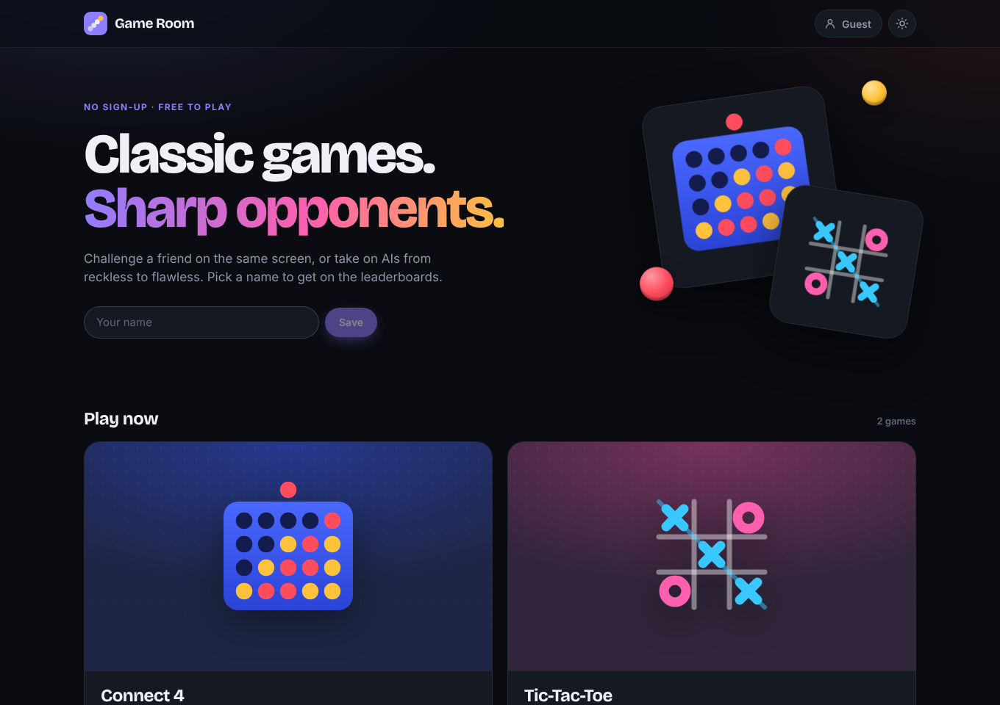
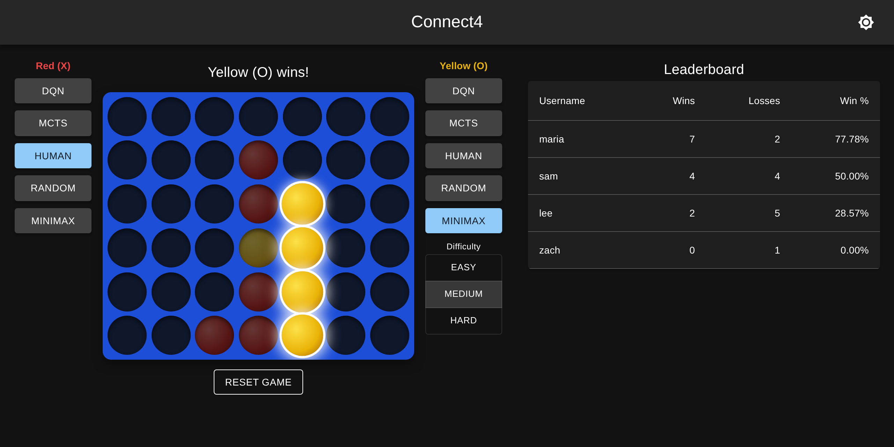

# Game Room

## Overview
A full-stack web app for classic two-player board games. Play against a friend on the same screen or against AI opponents, and climb each game's leaderboard. It started as Connect 4 and is built so more games can be added.





## Games
| Game | AI opponents |
| --- | --- |
| Connect 4 | Random, Minimax, MCTS (easy/medium/hard), DQN (placeholder) |
| Tic-Tac-Toe | Random, Minimax (easy/medium/hard; hard plays perfectly) |
| Reversi, Checkers, Dots and Boxes, Gomoku | Coming soon |

## Features
- **Home menu**: Pick a game; set a name once (remembered in the browser, no account needed).
- **Opponent choice**: Switch either side between a human and an AI at any time, with a difficulty setting for the stronger AIs.
- **Leaderboards**: One per game. Human-vs-AI games count wins, losses and draws, from the human's side.
- **Per-user games**: Every browser tab plays its own game of each type. Refreshing the page resumes it. Games are stored in Postgres, so they survive backend restarts; games untouched for a day are cleaned up.

## Adding a game
1. Backend: subclass `TurnBasedGame` (`backend/game/base.py`) with the board size, player types and rules (see `backend/game/tictactoe.py`), and add it to `backend/game/registry.py`.
2. Frontend: add a board component in `frontend/src/components/boards/`, register it in `frontend/src/pages/GamePage.tsx`, and add the game to the catalog in `frontend/src/games.ts` (or change its status from `coming-soon`).

## Technology Stack
- **Frontend**: React, TypeScript, Material UI
- **Backend**: Python, Pydantic
- **Database**: PostgreSQL
- **API Calls**: Axios, FastApi
- **Containerization**: Docker, Docker Compose
- **DQN Agent**: Pytorch

## Installation and Running the Application

### Prerequisites
- Docker and Docker Compose installed on your machine.

### Running the Application
To run the application, you can navigate to docker folder and run:

```bash
docker compose up
```
Interact with the app by going to 'localhost:3000'.

If you want to run each service individually instead, you can run the following command for each service (frontend,backend,postgres):

```bash
docker compose up <service>
```

### Running the backend tests
From the repository root:

```bash
pip install -e ".[dev]"
python -m unittest backend.game.env_testing backend.test_api backend.test_leaderboard backend.test_postgres_games
```

The leaderboard and Postgres game tests need a database and are skipped unless `TEST_DATABASE_URL` is set (they clear the `games` and `game_sessions` tables, so don't point them at real data). CI runs everything, including the frontend build, on every pull request.

To train the RL agents in `rl_agent/`, install the extra training dependencies with `pip install -e ".[rl]"`.

### API
| Method | Path | Description |
| --- | --- | --- |
| POST | `/games` | `{"game_type": "connect4" or "tictactoe"}` (default connect4) – start a new game; returns its `game_id` and state |
| GET | `/games/{game_id}` | Current state |
| POST | `/games/{game_id}/move` | `{"move": n}` – a column (0-6) in Connect 4, a cell (0-8) in tic-tac-toe. The AI replies automatically |
| POST | `/games/{game_id}/mode` | `{"player": 1 or 2, "mode": ..., "difficulty": "easy", "medium" or "hard"}`; the modes a game offers are listed in its state |
| POST | `/games/{game_id}/reset` | Restart the game, keeping the chosen players |
| GET | `/leaderboard/?game_type=...` | A game's leaderboard |
| POST | `/submit_game/` | `{"username": ..., "game_type": ..., "outcome": "win", "loss" or "draw"}` |

Games are stored in Postgres by default. Set `GAME_STORE=memory` to keep them in the backend's memory instead (no database needed for games, but they end when the backend restarts and only work with a single backend process). If a game is gone, the frontend starts a new one automatically.

## Upcoming
- **More games**: Reversi, Checkers, Dots and Boxes and Gomoku, each with AI opponents.
- **Trained DQN agent** for Connect 4 (training code is in `rl_agent/`).
- **Accounts**, so leaderboard names can't be used by someone else.

## Just for Practice
- **CI/CD Pipeline**
- **Hosting on AWS**
- **Integrate Stripe**


