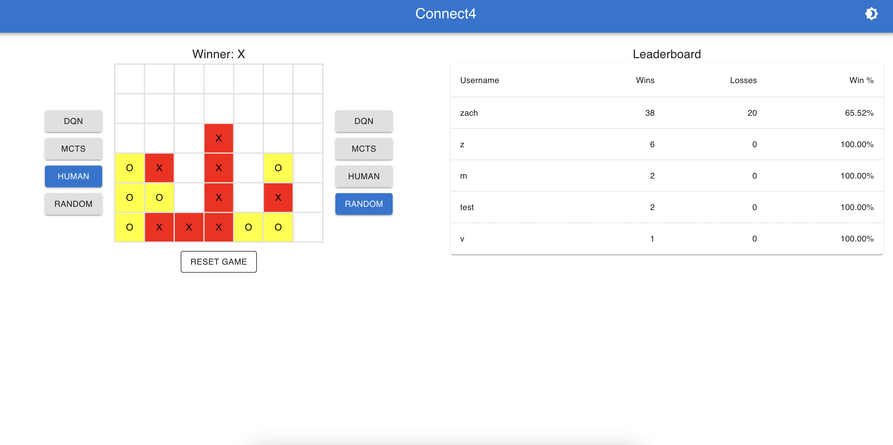

# Connect4 Game Application

## Overview
This Connect4 game is a full-stack web application that aims to replicate the classic Connect4 experience with additional features including various AI opponents and a leaderboard system.



## Features
- **Full-stack Connect4 Game**: A functional Connect4 game that can be played in a web browser.
- **Opponent Choice**: Switch your opponent at any time before, after, or during matches. 
- **Leaderboard**: A leaderboard that will track and display player rankings. Human-vs-AI games count, scored from the human's side.
- **Per-user games**: Every browser tab plays its own game. Refreshing the page resumes it; games idle for an hour are cleaned up.

## Technology Stack
- **Frontend**: React, TypeScript, Material UI
- **Backend**: Python, Pydantic
- **Database**: PostgreSQL
- **API Calls**: Axios, FastApi
- **Containerization**: Docker, Docker Compose
- **DQN Agent**: Pytorch

## Installation and Running the Application

### Prerequisites
- Docker and Docker Compose installed on your machine.

### Running the Application
To run the application, you can navigate to docker folder and run:

```bash
docker compose up
```
Interact with the app by going to 'localhost:3000'.

If you want to run each service individually instead, you can run the following command for each service (frontend,backend,postgres):

```bash
docker compose up <service>
```

### Running the backend tests
From the repository root:

```bash
pip install -e ".[dev]"
python -m unittest backend.game.env_testing backend.test_api backend.test_leaderboard
```

The leaderboard tests need Postgres and are skipped unless `TEST_DATABASE_URL` is set (they clear the `games` table, so don't point them at real data). CI runs everything, including the frontend build, on every pull request.

To train the RL agents in `rl_agent/`, install the extra training dependencies with `pip install -e ".[rl]"`.

### API
| Method | Path | Description |
| --- | --- | --- |
| POST | `/games` | Start a new game; returns its `game_id` and state |
| GET | `/games/{game_id}` | Current state |
| POST | `/games/{game_id}/move` | `{"column": 0-6}` – play a move (AI replies automatically) |
| POST | `/games/{game_id}/mode` | `{"player": 1 or 2, "mode": "human", "random", "minimax", "mcts" or "dqn"}` |
| POST | `/games/{game_id}/reset` | Restart the game, keeping the chosen players |
| GET | `/leaderboard/` | Leaderboard |
| POST | `/submit_game/` | `{"username": ..., "won": true or false}` |

Games are kept in the backend's memory, so restarting it ends them; the frontend then starts a new game automatically.

## Upcoming
- **Implementation of AI Agents**: Agents to be added include a Deep Q-Learning (DQN) agent, a Monte-Carlo Tree Search (MCTS) agent, and a Minimax with Alpha-Beta Pruning agent. 

## Possible Future Additions
- **Additional Games**: 
    - Primarily 2-player games
    - Each game will come with additional trained agents to play against.

## Just for Practice
- **CI/CD Pipeline**
- **Hosting on AWS**
- **Integrate Stripe**


